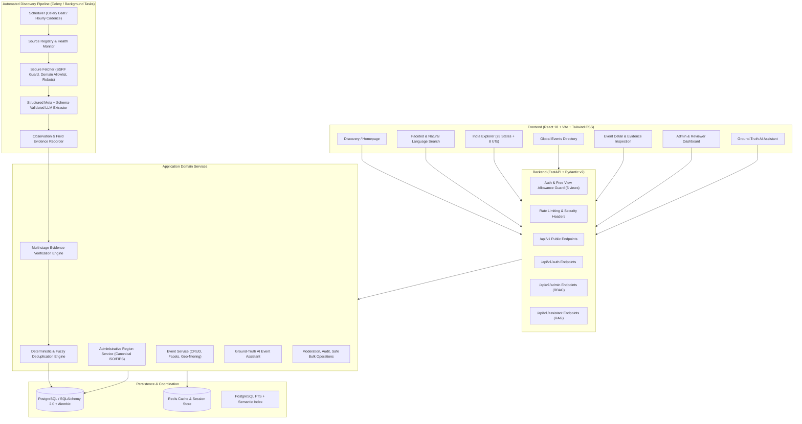

# EventHorizon AI — System Architecture & Technical Specifications

## 1. Executive Overview

**EventHorizon AI** is an AI-powered global technical event discovery and verification platform with a specialized **India-first geographic resolution engine**. It aggregates, extracts, verifies, deduplicates, and monitors hackathons, developer conferences, workshops, and coding competitions from multiple independent public sources, while strictly distinguishing verified facts from model-assisted inferences.

---

## 2. Architectural Principles & Priorities

1. **Accuracy and Trustworthy Information**: Zero hallucination on dates, registration URLs, deadlines, fees, or location. Unknown fields remain explicitly `Not specified`.
2. **Reliability and Security**: Defense in depth (SSRF protection on source crawling, parameterized ORM, role-based authorization, sanitization of untrusted web content).
3. **Speed and Scalability**: Bounded queries, indexed lookups, asynchronous background pipelines, multi-layer caching.
4. **Premium UI/UX**: Dark-mode primary, editorial developer typography, micro-interactions, responsive across mobile, tablet, and desktop.
5. **Explainable Personalization**: Grounded recommendations based solely on authentic stored event records and explicit user preferences.

---

## 3. High-Level System Architecture



---

## 4. Key Component Specifications

### 4.1 Frontend Architecture
- **Framework**: React 18, Vite (Fast HMR, optimized production chunks).
- **Language**: JavaScript (ES2024 with clean modular structure).
- **Styling**: Tailwind CSS with custom design tokens (Zinc/Slate dark slate palette, cyber-emerald verification accents, amber warning accents).
- **Icons**: Lucide React.
- **Motion**: Motion for React (Framer Motion) with strict performance guards (`prefers-reduced-motion` compliance, opacity/transform only).
- **Component Primitives**: Accessible UI patterns inspired by shadcn/ui.
- **Routing**: React Router v6 with code-splitting via `React.lazy`.
- **API Client**: Centralized Axios/Fetch client with interceptors for auth tokens, request IDs, rate-limit 429 backoff, and view allowance tracking.

### 4.2 Backend Architecture
- **Framework**: FastAPI (Asynchronous Python 3.13+).
- **Validation**: Pydantic v2 schemas for strict boundary validation.
- **ORM**: SQLAlchemy 2.0 async engine with declarative models.
- **Migrations**: Alembic with versioned revisions.
- **Database Support**: PostgreSQL primary (psycopg/asyncpg) with SQLite async fallback for isolated local unit testing.
- **Authentication**: JWT-based bearer tokens with secure HTTP-only cookie support, bcrypt password hashing, and role hierarchy (`ANONYMOUS`, `USER`, `MODERATOR`, `ADMIN`, `SUPER_ADMIN`).
- **Free Browsing Allowance**: Server-side IP + fingerprint/session tracker allowing 5 detailed event views before requiring free account registration.

### 4.3 India-First Geographic Resolution Engine
India comprises **28 states and 8 union territories**. To prevent cross-state leakage and false classification:
1. **Explicit Canonical Model**: Standardized ISO 3166-2:IN codes (e.g., `IN-TG` for Telangana, `IN-KA` for Karnataka, `IN-DL` for Delhi).
2. **Venue-First Heuristic**: An event is categorized under an Indian state **only** when explicit venue evidence confirms physical occurrence in that territory.
3. **Strict Negative Rules**:
   - Organizer location != Event location.
   - Mention of a city in sponsor/organizer context != Event venue.
   - Purely online events are tagged as `format: online` and never placed into state physical queues.
   - Ambiguous locations are flagged as `unverified_location` and placed in the administrative review queue.

### 4.4 Automated Discovery & Verification Pipeline
1. **Source Registry**: Tracks feed URLs, crawl frequency, rate limits, health scores, and legal terms.
2. **Secure Fetching**:
   - SSRF protection: Blocks RFC1918, link-local (169.254.0.0/16), and loopback IPs.
   - Enforces 15-second socket timeout and max 5MB download limit.
   - Treats extracted HTML as untrusted data (no script execution).
3. **Extraction**:
   - Deterministic metadata extraction (OpenGraph, Schema.org Event, JSON-LD, Microdata, RSS/Atom).
   - Structured LLM fallback with strict Pydantic parsing.
4. **Evidence Store**: Raw observations (`EventSourceObservation`) are preserved immutably. If two sources disagree on dates, both observations remain intact while the event enters `NEEDS_REVIEW`.
5. **Deduplication**:
   - Canonical URL normalization (stripping UTM tags, trailing slashes, tracking query params).
   - Title normalization (slugification, alphanumeric stripping) + date window matching.
   - Levenshtein / Token Sort similarity threshold (0.88+) triggers match candidates without automatic destructive merges.

### 4.5 AI Event Assistant
- **Design**: Retrieval-Augmented Generation (RAG) strictly grounded in confirmed database records.
- **Guardrails**: Prompt injection sanitization, system prompt isolation, and refusal to fabricate nonexistent events or links.
- **Response Format**: Markdown with embedded structured event citations linking directly to the verified internal event detail page and original source.

---

## 5. Security & Trust Architecture

| Vulnerability / Vector | Mitigation Strategy |
|---|---|
| **SSRF in Crawler** | DNS pre-resolution check; rejection of private IP ranges (10.0.0.0/8, 172.16.0.0/12, 192.168.0.0/16, 127.0.0.0/8, 169.254.0.0/16); redirect validation. |
| **SQL Injection** | Exclusively parameterized SQLAlchemy queries; no raw string interpolation. |
| **XSS** | React standard escaping + strict DOMPurify sanitization on markdown/external descriptions. |
| **Prompt Injection** | Scraped content wrapped in isolation delimiters; LLM forbidden from invoking internal admin tools or leaking system prompts. |
| **Broken Auth / RBAC** | Server-side dependency injection verifying role scopes on every administrative route. |
| **Accidental Data Loss** | Destructive bulk actions require `SUPER_ADMIN` role, explicit typed confirmation phrase, and immutable audit logs. |

---

## 6. Directory Structure

```
eventhorizon-ai/
  backend/
    app/
      api/
        routes/
          health.py
          events.py
          regions.py
          auth.py
          saved_events.py
          assistant.py
          admin.py
          reports.py
      core/
        config.py
        security.py
        database.py
        exceptions.py
      models/
        event.py
        region.py
        organizer.py
        observation.py
        user.py
        saved_event.py
        source.py
        audit.py
      schemas/
        event.py
        region.py
        auth.py
        assistant.py
        admin.py
      services/
        event_service.py
        region_service.py
        auth_service.py
        assistant_service.py
        verification_service.py
        dedup_service.py
      discovery/
        adapters/
        fetcher.py
        extractor.py
      workers/
        celery_app.py
        tasks.py
      main.py
    migrations/
    tests/
      test_health.py
      test_events.py
      test_geo_leakage.py
      test_verification.py
      test_auth.py
  frontend/
    src/
      app/
      components/
        ui/
        layout/
        events/
        search/
        admin/
        assistant/
      features/
      hooks/
      pages/
        HomePage.jsx
        EventsPage.jsx
        IndiaExplorerPage.jsx
        EventDetailPage.jsx
        SavedEventsPage.jsx
        AssistantPage.jsx
        AdminDashboardPage.jsx
        LoginPage.jsx
        RegisterPage.jsx
      services/
        api.js
      styles/
        index.css
  infrastructure/
    docker-compose.yml
    Dockerfile.backend
    Dockerfile.frontend
  docs/
    architecture.md
    implementation-plan.md
  .env.example
  README.md
```
